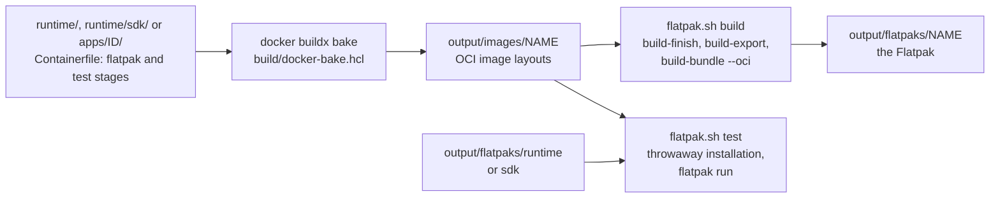
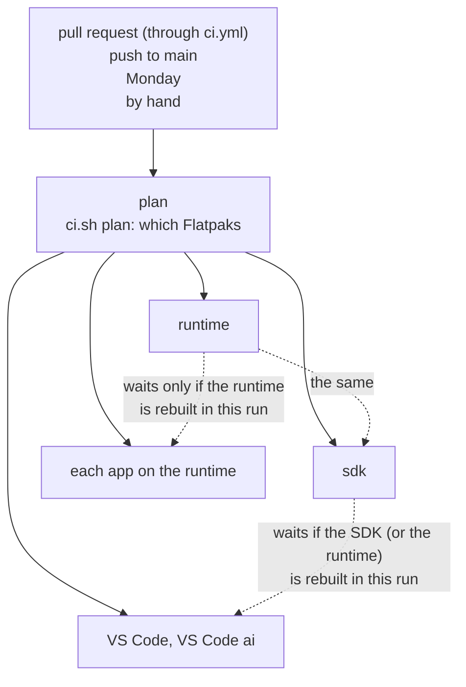
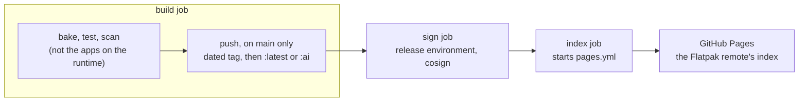

# Building, CI and updates

Needs docker with buildx, `just` and `jq`:

```sh
just devcontainer        # localhost/devcontainer:latest and :ai, into docker's image store
just flatpaks            # build and test the runtime, the SDK and their apps into output/flatpaks/
just flatpak NAME        # one of them (just flatpak-names), on the image and the Flatpak of its runtime built before
just flatpaks-install    # install every app with its runtime for your user (or one: just flatpaks-install ID)
just check               # every shell script's syntax, and a README.md in every app
just verify-pins         # every pin against upstream's signatures (cosign, gh, gpg, minisign, slsa-verifier)
```

## The build

The same locally and in CI:



- Everything is in [`build/`](../build/): the bake file, the builder
  ([`Containerfile`](../build/Containerfile), Fedora with flatpak),
  [`build.sh`](../build/build.sh) (what `just` runs),
  [`ci.sh`](../build/ci.sh) (CI's plan, build and push, through
  `build.sh`) and [`flatpak.sh`](../build/flatpak.sh), which runs in the
  builder.
- The Flatpak and its test are made side by side, in two privileged
  containers that see only `output/`. Nothing touches your own
  installations until `just flatpaks-install`.
- The names: `runtime`, `sdk`, each app's ID, and `<ID>-<variant>` for a
  `flatpak-<variant>` stage (`io.github.lucarickli.Code-ai`).
- The labels a `flatpak` stage sets (`flatpak.id`, `.runtime`, `.command`,
  `.finish-args.<group>`, …) are listed at the top of `flatpak.sh`. An
  unknown one fails the build.

## CI



Each box under the plan is the same pipeline,
[`flatpak.yml`](../.github/workflows/flatpak.yml), one per Flatpak, with
fail-fast off: an app that fails, or is slow, holds back no other's
release. A runtime (or the SDK) that the run rebuilds does hold back the
apps on it: they wait for its pipeline, and are skipped if it fails its
test.



- **What the plan picks**: on a pull request, what its changes can affect
  (built and tested, nothing pushed); on a push to `main`, each Flatpak
  whose sources changed since the run that last published it, and each
  whose last build failed (tested again); every Monday everything, the
  runtime (with the builder) built without the cache and the SDK on it,
  both pushed for Fedora's updates; by hand, everything, as fresh, and all
  of it pushed on `main`.
- **The PR gate**: [`ci.yml`](../.github/workflows/ci.yml) runs lint
  (actionlint, zizmor, `just check`, the Renovate config), the pin checks,
  and the dev container and Flatpak workflows where a PR affects them. Its
  last job, `ci-ok`, is the one required check. Every Monday it also checks
  every pin against upstream's signatures (`tools/verify-pins.sh`).
- **The cache**: every image is baked on `ghcr.io/<owner>/packages-cache`,
  read by every job and written only by runs on `main`. The builder and the
  runtime are built on the Fedora image their cache was built on
  (`base-fedora-<N>`), not on whatever Fedora's tag points at that day;
  the runtime's job on Monday and by hand takes the day's and keeps it
  there.
- **The test's runtime**: in CI an app is tested on the runtime machines
  get: the one this run pushed, else the published `:latest` (also on a
  pull request that does not change it); one made in the job where neither
  applies.
- **The index** ([`pages.yml`](../.github/workflows/pages.yml),
  [`index.sh`](../build/index.sh)): `https://<owner>.github.io/<repository>`
  lists every Flatpak's `:latest`, and `/ai` the same with VS Code's `:ai`.
  Metadata only: the images stay private. A Flatpak not published yet is
  left out, with a warning; run `pages.yml` by hand to publish the index
  again.
- **Pushes**: dated tag first, then `:latest` (`:<date>-ai`, then `:ai`,
  for VS Code's ai). An app goes out only once the runtime the run was to
  push is published. Runs on `main` queue behind each other (pull requests
  supersede each other), and a re-run of one that `main` has moved on from
  pushes nothing. [`private.sh`](../build/private.sh) refuses a push to a
  public package.
- **Others**: [`devcontainer.yml`](../.github/workflows/devcontainer.yml)
  builds, tests, scans, pushes and signs the dev container on change and
  every Monday; [`notify.yml`](../.github/workflows/notify.yml) opens an
  issue when a workflow fails on `main` and closes it on its next success.

Every download is retried, and every package is private, the owner's
alone: VS Code and Claude Code are not ours to hand out.

## Renovate

[`.github/renovate.json`](../.github/renovate.json):

- Minor, patch and digest updates go into one weekly PR
  (`renovate/weekly`). A major and the next Fedora release get PRs of
  their own, a Firefox release one at once.
- Each merges itself once `ci-ok` is green, 3 days after its release where
  the datasource tells.
- Held for you: a moved tag or a digest-only update (opened at once), and
  cosign with its installer (no PR can run signing).
- One failing update holds the whole weekly PR: push the fix to its branch.
- Every January, Deno's first release fails `install.sh` until its
  `LICENSE.md` sha256 in `tools/tools.txt` is pinned anew.

## Signing

Every pushed digest is signed with a private cosign key, in each
pipeline's `sign` job. It takes `SIGNING_SECRET` from the `release`
environment (only `main` may use it) and verifies against
[`keys/cosign.pub`](../keys/cosign.pub). flatpak itself checks no cosign
signature; a machine needs to be configured to verify image signatures.
A Flatpak counts as published once its build job passed and, where it
pushed, its sign job too: one whose signing fails is pushed again by the
next run on `main`.

## Adding an app

1. `apps/<ID>/Containerfile`:
   - a build stage `FROM runtime` (or `FROM sdk`) that fills `/app`,
     checking every download;
   - `FROM scratch AS flatpak` with `COPY --from=build /app /app` and its
     labels: `flatpak.id`, `flatpak.runtime=<runtime ID>//<branch>` (the
     branch is `runtime/Containerfile`'s `flatpak.branch`),
     `flatpak.command`, and a `flatpak.finish-args.<group>` per reason,
     the reason in a comment;
   - last, `FROM flatpak AS test` with
     `COPY --chmod=0755 test.sh /app/bin/<command>-test` and
     `LABEL flatpak.command=<command>-test`.

   A `flatpak-<variant>` and `test-<variant>` stage make a variant.

2. `apps/<ID>/test.sh`, run in the app's sandbox, and `apps/<ID>/README.md`
   (what it is, how to install it; `just check` wants it).
3. Its line in `APPS` in [`docker-bake.hcl`](../build/docker-bake.hcl):
   `id`, `on` (`runtime` or `sdk`), `contexts` where it copies from
   `tools/` or `keys/`, `variants`. Every recipe and the plan fail where
   `apps/` and `APPS` differ.
4. Pin its upstream so that Renovate updates it. The line right under
   `# renovate: datasource=<datasource> depName=<name>` (plus
   ` extractVersion=^v(?<version>.+)$` where the tag has more than the
   version, and nothing else on that line: a versioning goes in a package
   rule) is `ARG <NAME>_VERSION=<version>`; for a release built from its
   git tag, add ` <NAME>_COMMIT=<40 hex>` on the same `ARG` line.
5. `just flatpak <ID>`, then `just flatpaks-install <ID>`. On `main`, CI
   pushes it, signs it and lists it in the index.

## A new Fedora release

Renovate's Fedora PR (`renovate/fedora`) moves the dev container, the
builder, the runtime and the SDK together (the FROM lines, the
`flatpak.branch` labels and every `flatpak.runtime` naming them), and
merges itself once everything is built and tested on the new release.

One thing no manager follows: [`runtime/fontconfig/`](../runtime/fontconfig/),
a copy of Fedora's flatpak-runtime-config. When the PR opens, compare it
with branch `f<N>` of
[rpms/flatpak-runtime-config](https://src.fedoraproject.org/rpms/flatpak-runtime-config),
and push the changed files, with the branch and commit in the comment
above `COPY fontconfig/` in `runtime/Containerfile`, to the PR's branch.
The old runtime stays on machines until `flatpak uninstall --unused`.

## A new copy

Its settings:

- auto-merge allowed;
- [`.github/rulesets/main.json`](../.github/rulesets/main.json) imported
  (Rules, Rulesets, Import a ruleset), which makes `ci-ok` required;
- private vulnerability reporting on, where
  [`SECURITY.md`](../.github/SECURITY.md) sends reporters;
- the `release` environment with the `SIGNING_SECRET` secret, deployment
  branches limited to `main`;
- Pages with source GitHub Actions (Settings, Pages);
- the Renovate GitHub App, with its workflow permission.

A package that already exists, pushed from another repository (the dev
container, `code`, a Flatpak's, `packages-cache`), needs this repository
given Write in its settings (Manage Actions access), and must be private
(Danger Zone, Change visibility) before the first push to `main`, or every
push to it is refused: `code` and `devcontainer`, pushed from `devtools`,
were public. `build/private.sh ghcr.io/<owner>/<name>` tells. Machines then
pull with a token that reads packages, as the app READMEs say.
